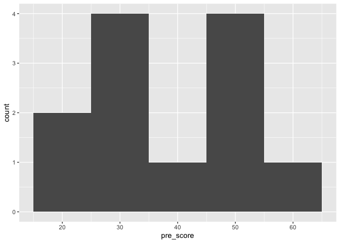
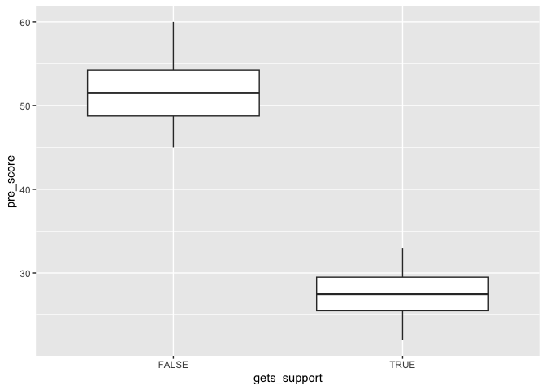
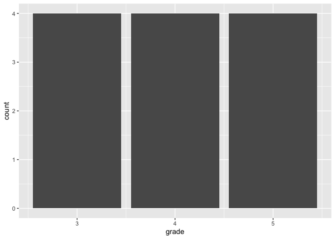
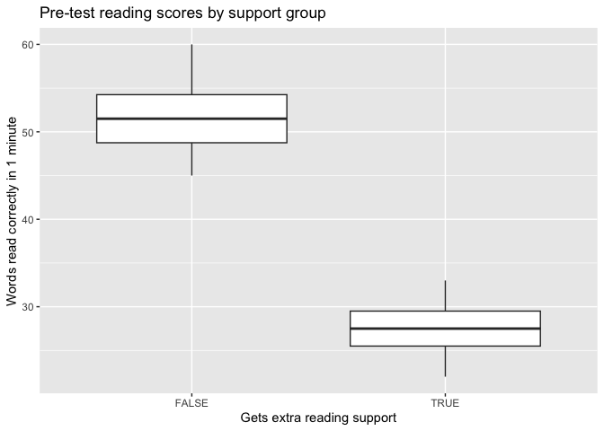

# Graphs of Simulated Reading Scores
Hyeyoung
2026-11-19

\##Load data

The data are simulated reading fluency scores of 12 studenrs. All values
are made up for practice.

``` r
#load tidyverse(ggplot2 is inside it)
library(tidyverse)
```

    Warning: package 'ggplot2' was built under R version 4.4.3

    Warning: package 'tidyr' was built under R version 4.4.3

    Warning: package 'readr' was built under R version 4.4.3

    Warning: package 'stringr' was built under R version 4.4.1

    Warning: package 'forcats' was built under R version 4.4.1

    Warning: package 'lubridate' was built under R version 4.4.3

    ── Attaching core tidyverse packages ──────────────────────── tidyverse 2.0.0 ──
    ✔ dplyr     1.1.4     ✔ readr     2.2.0
    ✔ forcats   1.0.1     ✔ stringr   1.6.0
    ✔ ggplot2   4.0.2     ✔ tibble    3.2.1
    ✔ lubridate 1.9.5     ✔ tidyr     1.3.2
    ✔ purrr     1.0.2     
    ── Conflicts ────────────────────────────────────────── tidyverse_conflicts() ──
    ✖ dplyr::filter() masks stats::filter()
    ✖ dplyr::lag()    masks stats::lag()
    ℹ Use the conflicted package (<http://conflicted.r-lib.org/>) to force all conflicts to become errors

``` r
#read the cleaned data from the data folder(one folder up)
scores <- read_csv("../data/reading_scores_clean.csv")
```

    Rows: 12 Columns: 6
    ── Column specification ────────────────────────────────────────────────────────
    Delimiter: ","
    chr (1): student_id
    dbl (4): grade, pre_score, post_score, gain
    lgl (1): gets_support

    ℹ Use `spec()` to retrieve the full column specification for this data.
    ℹ Specify the column types or set `show_col_types = FALSE` to quiet this message.

\##Histogram of pre-test scores

``` r
#draw a histogram of pre-test scores with 10-point bins 
ggplot(scores, aes(x = pre_score)) + 
  geom_histogram(binwidth = 10)
```



\##Boxplot of pre-test scores by support group

``` r
#compare pre-test scores between the two support groups
ggplot(scores, aes(x = gets_support, y = pre_score)) +
  geom_boxplot()
```



\##Number of students by grade

``` r
ggplot(scores, aes(x = grade)) +
  geom_bar()
```



\#compare pre-test scores between the two support groups

``` r
ggplot(scores, aes(x = gets_support, y= pre_score))+
  geom_boxplot() +
  labs(
    title = "Pre-test reading scores by support group",
    x = "Gets extra reading support",
    y = "Words read correctly in 1 minute"
  )
```



\##Interpretation The histogram shows that the pre-test scores are
divided into two clusters, one around 20-30 and the other around 45-60,
with almost no students in between. The boxplot shows that these two
clusters correspond to whether studend received support: the mean
pre-test score was 51.8 for the non-support group and 27.5 for the
support group. Therefore, looking only at the overall mean would hide
the fact that the scores are split into two groups.
